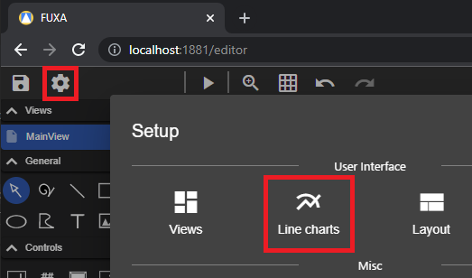

To add a **Chart** Control to a View:: going in editor and select the View.

In **Line charts** you can define your diagrams to be attached to the chart control.

## Machine states alongside trends

Add the numeric and state tags to the same chart in **Line charts**. Edit each state
tag and change **Series type** to **Machine state**. The series label names its lane.
Numeric trends keep their existing colors, interpolation and Y-axis settings.

Use **Add state** to map a tag value to a label, color and optional description. For
example, map `0` to **Stopped** in red, `1` to **Running** in green and `2` to
**Setup** in orange. Match the values supplied by the tag: `true`/`false` for
booleans, or `0`/`1` for tags that encode them as numbers. Values are compared as
text, so numeric `1` and string `"1"` use the same mapping. Each mapping value must
be unique. Unmapped values, including recipe names, appear as their original text
with the default state color. Hover over an interval to read its full label and
description when it is too narrow to display the text.

Each state continues until the next recorded state change. Repeated samples of the
same value form one interval. A missing sample in another series does not interrupt
the state; an explicit null value marks a gap. Millisecond timestamps are retained.

State lanes share the trend's time range: zooming or panning the trend, changing the
history range, or refreshing updates all lanes together. If mouse-wheel navigation
is enabled, it also works over the state lanes. Multiple lanes can be scrolled
vertically without reducing the numeric plot to an unreadable height.

For historical charts, enable DAQ recording for the state tags. A lane starts at
the first state sample returned for the selected range: the chart does not guess
a state before that sample. Live charts retain the last known state when older
samples leave the visible time window. Existing projects remain numeric trends
unless a series is explicitly changed to **Machine state**.
