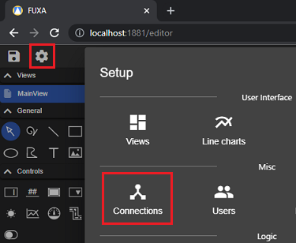

To add your Device and Tags going to **Connections** in editor.

Add and connect a **OPCUA** device.

To add OPCUA Tags the device have to be connected.

To add a **Modbus** connection you have to install the driver in **Plugins**

Add a **MQTT** connection and a topic subscription

Add a **WebAPI** connection and a Tag of the JSON result

**SNMP**

Add a **SNMP** connection to read and write scalar OIDs of a SNMP agent (v1, v2c or v3).
In the device property set the agent address and port (default 161), the SNMP version and the credentials:
the community for v1/v2c, or user name, security level, authentication/privacy protocols and keys for v3.
The credentials are stored encrypted with the device security and never in the project file.

Each Tag address is the numeric OID with instance, for example `1.3.6.1.2.1.1.5.0` (sysName),
or a MIB name with module and instance, for example `SNMPv2-MIB::sysName.0` or `IF-MIB::ifInOctets.3`.
The standard modules (SNMPv2-MIB, IF-MIB, RFC1213-MIB, ...) are built in; vendor MIB files can be uploaded from the
device property (they are stored in the `_mibs` directory of the server and loaded when the device is saved or started).
The names are resolved on the server, the scan shows the known name of each OID and uses it as Tag name.
With the device connected you can also use **Scan Tags** from the add button of the Tags list: it walks a subtree of the agent
(default `1.3.6.1.2.1`, mib-2) and lets you select the OIDs to import with the type and the current value found.
The Tag type is used to encode the value for writes (SET) and to coerce the read value:
`Integer`, `Counter32`, `Gauge32`, `Unsigned32`, `TimeTicks` and `Counter64` are numbers,
`OctetString`, `IpAddress` and `OID` are strings, `Hex` shows an OctetString as hexadecimal string (ex. MAC addresses).

**Traps and informs**: enable *Receive traps and informs* in the device property to listen on the trap port (default 162,
on Linux a port below 1024 needs privileges, otherwise configure the agent to send to a port above 1024).
Notifications are accepted only from the device address and with the same credentials of the session (community or v3 user).
Each varbind of the notification updates the Tag with the same OID: for example a Tag with address `1.3.6.1.6.3.1.1.4.1.0` (snmpTrapOID.0)
receives the OID of the last trap, usable to trigger alarms or scripts. For v1 traps sysUpTime.0 and snmpTrapOID.0 are built as RFC 3584.
Mark the Tags that exist only in the notifications with *Updated only by traps/informs*, so they are not polled. Informs are acknowledged.

Notes:
- SNMP uses UDP, the connection status is driven by the answers to the polling: after the configured polls without answer the device reconnects.
- The DES privacy protocol needs the OpenSSL legacy provider on Node.js 17 and later, prefer AES.
- `Counter64` values above 2^53 lose precision as JavaScript numbers.

**Tag Options**

If you have any Tag types which don't have a defined data type you can set this. For example TIME data type is no a defined type, but the base data type is normally int64 or uint64 and the time is in milliseconds.

You can also under tag options use the scale script to do any data type conversions etc for example the data from TIME is an array of LOW and HIGH, we can create a simple script to grab the array element and return it as a number type. We can then just return the actual value for write if needed.

**Important!** the script parameter must be called value as there is a filter to display relevant scripts for selection. Do not use comments in this script as they are not supported. 

Here is the read script which returns the array element

Here is the write script returning the actual tag value

 